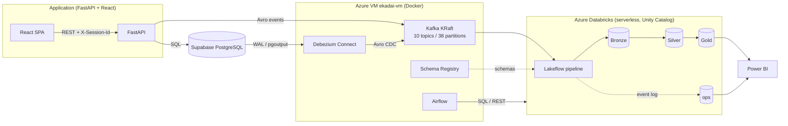

# Ekadai — architecture & design

A real e-commerce application whose transactions and clickstream flow in real time through
Kafka and Change Data Capture into a Databricks lakehouse (Bronze → Silver → Gold), with
observability, recovery tooling and Power BI on top. `MASTER_BUILD_PROMPT.md` is the
authoritative contract; this document explains what was built and why (§110).

## 1. Objective

Show an end-to-end, production-shaped data platform on a real application rather than toy data:
- authoritative state in PostgreSQL, captured with CDC;
- behavioral events with enforced contracts;
- streaming ingestion;
- validated, deduplicated, history-preserving Silver;
- dimensional Gold;
- explicit handling of the hard cases: late data, unknown references, out-of-order and
  duplicate CDC, replay and backfill.

## 2. Architecture

**Where things run:**
- **Supabase** hosts Postgres. The app reaches it through the IPv4 session pooler; Debezium
  uses the IPv6 direct connection, because logical replication can't go through a pooler.
- **One Azure VM** (Standard_D2ns_v6, East US, dual-stack) runs Kafka, Schema Registry, Kafka
  Connect with Debezium, and Airflow, each in Docker.
- **Azure Databricks** (Premium, Unity Catalog, ADLS Gen2 `ekadailake`) runs **one serverless
  Lakeflow Declarative Pipeline** with four sources (Bronze, Silver events, Silver CDC, Gold),
  plus a serverless SQL warehouse for ad-hoc SQL, Airflow and Power BI.

## 3. Application

- **Backend**: FastAPI + SQLAlchemy + Alembic, in `app/` and `db/`. It covers auth (JWT),
  catalog with search/filter/sort/ratings, cart, wishlist, checkout snapshots, orders (created
  in one transaction with the promotion engine), cancellation, Buy Now (bypasses the cart) and
  reviews.
- **Frontend**: React + Vite + TypeScript, in `web/`.
- The app emits events through `events/producer.py`, behind a swappable transport: logging
  locally, Kafka + Avro in the cloud. Emission never blocks or fails a request.

## 4. PostgreSQL schema

There are 12 transactional tables plus `reviews`; see `db/models/` and the Alembic
migrations.
- Money is `NUMERIC`; there's never a float for money (§111).
- Orders go straight to `CONFIRMED`; there's no PENDING state (§111).
- Order lines snapshot the historical `unit_price` / `discount_amount` / `line_revenue`.
- Five tables are CDC-captured (§45): `users`, `products`, `categories`, `orders` and
  `order_items`. They're owned by a dedicated `debezium` role and use `REPLICA IDENTITY FULL`,
  so updates carry the full before-image.

## 5. Behavioral events

- There are 18 event types, each with an Avro schema in `events/schemas/`, sharing a common
  envelope: `event_id` (UUID), `event_type`, `schema_version`, `event_timestamp` (epoch ms,
  user-action time), `producer`, `context` (user_id, session_id), `device` and `payload`.
- 10 are server-emitted (e.g. `order_created`) and 8 are client-emitted through
  `POST /events`, which only accepts the client types. The server fills in ids, session and
  device.
- Behavioral `order_created` is a milestone, never authoritative order state (§111): order
  facts come from CDC.

## 6. Kafka topology

- A single KRaft broker (no ZooKeeper, §37) with 7-day retention.
- Five behavioral topics (`user-`, `product-`, `cart-`, `checkout-`, `order-events`) and five
  CDC topics (`cdc-*`), 38 partitions in total.
- Partition keys preserve per-entity order (§39): e.g. `cart_id` for cart events, `order_id`
  for order items (a Debezium `message.key.columns` override).

## 7. Schema Registry

- Confluent Schema Registry with BACKWARD compatibility.
- Behavioral topics use **TopicRecordNameStrategy**, since each topic carries several record
  types (subject `topic-namespace.Record`).
- Messages use the Confluent wire format (magic byte + 4-byte schema id).
- Bronze resolves the schema id of every message, so evolution needs no pipeline change.

## 8. Debezium CDC

- One connector: `pgoutput`, a filtered publication, a dedicated replication slot, and an
  initial snapshot.
- `RegexRouter` SMTs map Debezium's topic names onto the `cdc-*` topics.
- Change position (the LSN), transaction id and snapshot flags are preserved all the way into
  Silver (§46–48).

## 9. Bronze (`ekadai_databricks.bronze`)

- `bronze_events` and `bronze_cdc_<entity>` keep the full decoded envelope (`raw_payload`),
  the original bytes (`raw_value`), `decode_error`, and Kafka lineage.
- The decoder never raises. An undecodable message becomes a Bronze row plus a quarantine
  entry instead of stopping the stream (§42, §51).

## 10. Silver (`ekadai_databricks.silver`)

- **`silver_events`** (§54): typed columns only (no raw payload as the model, §111). Written
  with AUTO CDC keyed on `event_id`, so duplicates collapse (§56) and rows can be corrected in
  place.
  - Validation (`silver_rules.py`, 59 unit tests) routes MALFORMED / SCHEMA_INVALID /
    BUSINESS_RULE failures to `silver_event_quarantine` (§64).
  - `silver_event_filters` holds one row per filter (§68).
- **CDC**:
  - `silver_cdc_orders` / `silver_cdc_order_items` are change logs, one row per change (§69–70),
    with `status_before`/`status_after`.
  - `silver_products` / `silver_categories` / `silver_users` are SCD2 (§71–73), maintained by
    AUTO CDC `stored_as_scd_type=2` and **sequenced by WAL position**. Late or out-of-order
    changes slot into history correctly; duplicates are dropped; deletes close the current
    version.
  - Only real attribute changes open a new version (tracked columns).
  - They're exposed as spec-shaped UC views: deterministic version keys, `valid_from`,
    `valid_to` and `is_current`.

## 11. Gold (`ekadai_databricks.gold`)

- **Dimensions**: `dim_user`, `dim_product` and `dim_category` (SCD2 versions), `dim_date`
  (YYYYMMDD, ISO weeks) and `dim_device`.
- **Facts**: `fact_events`, `fact_sessions` (30-min inactivity), `fact_orders` (one row per
  order, current status from CDC) and `fact_order_items` (historical prices).
- **Aggregates**: `agg_user_activity`, `agg_conversion_funnel` (15-min abandonment),
  `agg_product_performance`, `agg_daily_revenue` (cancellations on the cancellation date),
  `agg_order_metrics` and `agg_product_attribution` (7-day view→purchase, §89).
- All of these are **materialized views**: Gold is a pure function of Silver, so upstream
  corrections (reference resolution, late replay, cancellations) reach Gold on the next
  refresh, idempotently.
- Facts join the dimension version valid at the fact's time (§78).
- Surrogate keys are deterministic hashes (§76).

## 12. Reference resolution (§60–63)

- Each event's user, product and category are checked **independently** against what CDC has
  delivered, giving `RESOLVED` / `PARTIALLY_RESOLVED` / `UNRESOLVED`. The event stays valid;
  unknown references never quarantine it.
- When a missing reference arrives, the affected events are re-derived from Bronze and
  re-emitted into the **same** AUTO CDC flow with a higher sequence, which updates the row by
  `event_id` (never a second row).
- It's race-free: one flow's micro-batches are sequential, and existence is looked up in the
  same Bronze tables the triggers stream from.
- `reference_resolution_queue` is a derived view of every reference some event needed before
  it arrived (PENDING / PROCESSING / RESOLVED / FAILED).

## 13. Late data (§65–67)

- `lateness = Kafka append time − event time`. `is_late` is over the 10-min watermark;
  `is_too_late` is over watermark + 5-min allowed lateness. Both thresholds are pipeline
  config.
- Too-late events stay in Silver, but Gold admits them only once the **Airflow
  `late_data_replay` DAG** has verified the exact event in Bronze and marked its
  `late_data_replay_queue` row PROCESSED (§66–67).
- Measured lateness on real traffic was under 6s at max, so the thresholds are generous
  starting values (§65).

## 14. Backfill (§93–94)

- The **`backfill_reconcile`** DAG, triggered manually, rebuilds selected Silver tables from
  Bronze (a pipeline update with `full_refresh_selection`, recomputing Gold in the same update),
  then runs reconciliation checks:
  - every decodable Bronze event is accounted for in Silver or quarantine;
  - every undecodable one is quarantined;
  - no duplicate event ids;
  - Gold facts = admitted Silver;
  - one fact row per order and per item;
  - aggregate totals = fact totals.
- Every run gets a `backfill_id`, an `ops.backfill_audit` row (range, version, commit, counts,
  errors, verdict, `supersedes_backfill_id`) and per-check `ops.reconciliation_results`.

## 15. Observability (`ekadai_databricks.ops`, §97–102)

- The pipeline's event log is published to `ops.pipeline_event_log`.
- Views: `pipeline_runs`, `pipeline_stage_metrics` (Pipeline → Stage → Flow),
  `latency_metrics` (ingestion / processing / end-to-end percentiles, §58),
  `data_quality_metrics`, `reference_resolution_status`, `late_replay_status`, `kafka_lag`
  (Kafka offsets sampled by the `kafka_cdc_health` DAG vs Bronze's consumed offsets),
  `cdc_connector_health` and `retention_status`.
- `lakehouse_maintenance` (daily) prunes the ops samples, runs OPTIMIZE/VACUUM on the tables
  Airflow writes, and fails loudly on retention breaches.

## 16. Power BI

See [powerbi.md](powerbi.md): connection, star-schema model, DAX measures, and the Business vs
Platform Observability pages (§103–104).

## 17. Failure scenarios

See [failure_testing.md](failure_testing.md) for the §107 matrix and results. The injections
are in `scripts/failure_tests.py`.

## 18. Cost

- The biggest cost is the **serverless pipeline in continuous mode**, which bills around the
  clock.
  - On the fixed credit budget, it runs **triggered**: each update processes everything new and
    stops. Kafka's 7-day retention absorbs the gaps.
  - Flip it to continuous for live operation or demos. Latency is then ~13s end to end for
    events and ~23s for CDC.
- The SQL warehouse auto-stops after 1 minute; the Airflow DAGs wake it hourly or less often.
- The VM (D2ns_v6) costs little and can be deallocated. Its IPs are Standard (static), so
  Kafka's advertised address survives.
- Storage is negligible.
- Things avoided on purpose: Event Hubs, Confluent Cloud, and a second always-on cluster
  (§111).

## 19–21. Deployment

- **Local development**: Docker Postgres + `scripts/bootstrap.*`, then `uvicorn` and
  `npm run dev` (see the README). `EVENT_TRANSPORT=logging` needs no Kafka. Local Kafka and
  Debezium Compose files are in `kafka/` and `debezium/`.
- **Cloud**:
  - Supabase: `alembic upgrade head`, the seed, and `python -m debezium.setup_postgres`.
  - VM: `azure/vm-stack/` (Kafka stack) and `azure/vm-stack/airflow/`, then topic, schema and
    connector registration with `kafka/create_topics.py`, `kafka/register_schemas.py` and
    `debezium/register_connector.py`.
  - Databricks: `databricks/provision.ps1` (storage, workspace, Unity Catalog, NSG rule,
    pipeline, views).
  - Secrets live only in `.env` / the VM's `airflow.env`, never in git.

## 22. Design trade-offs

- **Single pipeline, not several jobs**: one compute, simple dependencies, and consistent
  micro-batches for reference resolution.
- **Gold as materialized views**: exact, self-correcting and idempotent, at the cost of
  recomputation. That's cheap at this scale; at larger scale the fact tables would become
  incremental streaming tables.
- **Reference resolution re-derives from Bronze** rather than reading Silver back (the pipeline
  graph forbids a flow reading its own target). This costs a little extra decoding and buys
  race-freedom.
- **Lateness measured at Kafka append time**, not Bronze ingestion time, so replays never make
  history "late".
- **Supabase instead of a self-hosted Postgres**, with an IPv6-capable VM for Debezium's
  direct connection.
- **Retention on pipeline-managed tables is monitored, not auto-deleted**: deleting underneath
  a streaming source breaks its readers. Enforcement would move into the pipeline (or use
  change-commit-skipping readers) before real data volumes accumulate.
